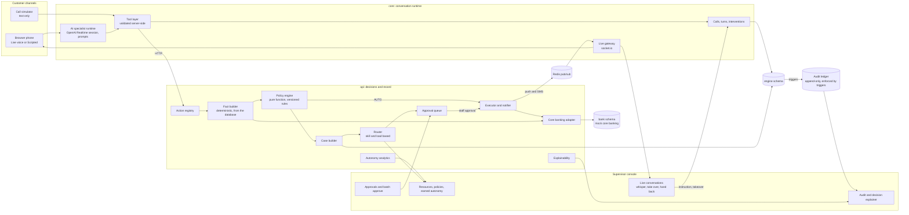

# AI phone specialist with live human oversight

Westpac Hackathon 2026, "AI and what it means for Banking". Prototype, mock data only.

**The problem.** We rang a typical bank phone line: "press 1 for...", then an
account number, then a passkey, and when we asked for a person we were told
to download the app. The customer does all the work and the call is
deflected, not resolved.

**The product.** An AI phone specialist that answers straight away and
resolves the call in natural conversation. No menus, no account number, no
passkey: it recognises the caller ID and confirms identity with a push to the
customer's banking app. Staff do not sit in a hold queue. They supervise many
AI-handled conversations at once and can watch, whisper an instruction, take
over, hand back, and approve or reject what the AI proposes.

1. **The AI proposes, deterministic policy decides, humans oversee.**
2. **Resolve, don't deflect.** Asking for a human gets you a human, with full context.
3. **Staff are redeployed, not replaced.** One specialist supervises many conversations.

| Tier | What happens | Example |
| --- | --- | --- |
| 1, auto | Low-risk, reversible actions run instantly | Temporary card lock |
| 2, approve | The AI builds a case pack for the staff approval queue | Fee refund, hardship request |
| 3, escalate | Scam, vulnerability or "I want a person" goes to a specialist. The AI never releases money | Held payment |

## Start

You need Docker. Nothing else is required for Scripted mode and the simulator.

```bash
cp .env.example .env          # optional: add OPENAI_API_KEY for Live voice
./start.sh                    # db, cache, api, core and app, all in Docker
```

| | |
| --- | --- |
| Supervisor console | http://localhost:3000 |
| Customer phone | http://localhost:3000/phone (open in a second window) |
| `core` health | http://localhost:3001/core/health |
| `api` health | http://localhost:3002/api/health |

Without Docker for the services (needs [bun](https://bun.sh) and Node 20+; only Postgres and Redis run in containers):

```bash
./dev.sh
```

Stop with `./stop.sh`. The dev containers under `api/.devcontainer`,
`core/.devcontainer` and `app/.devcontainer` still work as before.

## Reset

- **Reset demo** in the console header (shown when `DEMO_MODE=true`) reseeds
  the database in place and stops the simulator.
- `./reset.sh` wipes the database volume and reseeds from `db/*.sql`.

All seed timestamps are relative to `now()`, so the data always looks fresh.

## Live and Scripted mode

The customer phone has a **Live / Scripted** switch.

- **Scripted** (default, works offline): the phone replays a voiced script
  for Sarah, Daniel, Priya or Margaret using the browser's speech synthesis,
  through the same pipeline as a real call: tools, policy engine, cases,
  notifications, supervisor controls and audit. You still tap **Approve** on
  the identity push yourself.
- **Live**: set `OPENAI_API_KEY` in `.env` (or `core/.env`) and restart
  `core`. The phone opens a WebRTC session to the OpenAI Realtime API with an
  ephemeral secret minted by `core`. The key never reaches the browser. If
  the live connection fails, a toast offers Scripted mode.

## Simulator

On the dashboard: **Start simulation** (1 to 6 calls), **Stop**, **Speed**
1x or 2x. Simulated calls are text only and go through the same tool
endpoints, policy engine, cases, notifications and audit trail. Starting 5
gives you a routine balance query, a frustrated caller who asks for a person
(routed to Jordan Lee), a card lock, a call that waits for a supervisor
whisper, and a confused elderly caller where vulnerability is flagged.

## Layout

```
db/     01_schema.sql, 02_seed.sql, 03_views.sql        see db/README.md
api/    NestJS  REST API, system of record, deterministic decision pipeline   :3002 /api
core/   NestJS  phone calls and AI runtime, live socket gateway               :3001 /core
app/    Next.js supervisor console and simulated customer phone               :3000
```

`coding_standard.md` applies everywhere: snake_case files, folders, variables
and JSON; camelCase functions; PascalCase classes; custom error classes.

## Architecture



## Security and safety

- **No voice-only identity.** Caller ID plus an in-app push. Voices can be
  cloned, so a voice is never proof of identity.
- **Every tool call is validated server-side.** The model's claimed facts are
  never trusted: the customer is always the verified caller, card and account
  ids must belong to them, and amounts must match the database.
- **Hard facts never come from the model.** The fact builder computes them
  from the database. The model contributes only soft signals and quotes.
- **Supervisor instructions cannot bypass policy.** A whisper guides the
  conversation; every action still goes through the policy engine.
- **Releasing held money is never automatic.** Every rule in that policy
  escalates, and only a fraud specialist's decision can release it.
- **Append-only audit at the database level.** Triggers write the audit
  events and reject `UPDATE`, `DELETE` and `TRUNCATE`. The Audit page has a
  button that tries, and shows the database refusing.
- The OpenAI key lives only in `core`. The browser receives a short-lived
  client secret.

## Tests

```bash
cd api  && bun run test && bun run test:e2e     # policy engine for every persona, decision pipeline against the real database
cd core && bun run test                         # tool validation, script runner, simulator, metrics, voice session payload
./acceptance_test.sh                            # build prompt section 12, steps 1 to 7, against the running stack
```

## More

- `DEMO_SCRIPT.md`: click-by-click runbook for the 5-minute presentation and the 10-minute video.
- `DECISIONS.md`: every assumption made while building.
- `db/README.md`: the two schemas and the personas.
