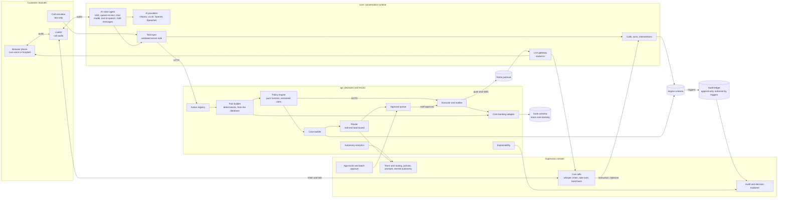

# AI phone specialist with live human oversight

Westpac Hackathon 2026, "AI and what it means for Banking". Prototype, mock data only.

**The problem.** We rang a typical bank phone line: "press 1 for...", then an
account number, then a passkey, and when we asked for a person we were told
to download the app. The customer does all the work and the call is
deflected, not resolved.

**The product.** An AI phone specialist that answers straight away and
resolves the call in natural conversation. No menus, no account number, no
passkey: it recognises the caller ID and confirms identity with a push to the
customer's banking app. Staff do not sit in a hold queue. They supervise many
AI-handled conversations at once and can watch, whisper an instruction, take
over, hand back, and approve or reject what the AI proposes.

1. **The AI proposes, deterministic policy decides, humans oversee.**
2. **Resolve, don't deflect.** Asking for a human gets you a human, with full context.
3. **Staff are redeployed, not replaced.** One specialist supervises many conversations.

| Tier | What happens | Example |
| --- | --- | --- |
| 1, auto | Low-risk, reversible actions run instantly | Temporary card lock |
| 2, approve | The AI builds a case pack for the staff approval queue | Fee refund, hardship request |
| 3, escalate | Scam, vulnerability or "I want a person" goes to a specialist. The AI never releases money | Held payment |

## Start

You need Docker. Scripted mode and the simulator need nothing else; Live
voice also needs a chat model (see [Live voice](#live-voice)).

```bash
cp .env.example .env              # infrastructure only: ports and container credentials
cp api/.env.example api/.env      # api's own settings and secrets
cp core/.env.example core/.env    # core's own settings, secrets and AI providers
cp app/.env.example app/.env      # browser-facing service URLs
./start.sh                        # db, cache, LiveKit, speech, api, core and app, all in Docker
```

| | |
| --- | --- |
| Supervisor console | http://localhost:3000 |
| Customer phone | http://localhost:3000/phone (open in a second window) |
| `core` health | http://localhost:3001/core/health |
| `api` health | http://localhost:3002/api/health |
| AI providers status | http://localhost:3001/core/ai/status |

Without Docker for the services (needs [bun](https://bun.sh) and Node 20+;
Postgres, Redis, LiveKit and Speaches still run in containers):

```bash
./dev.sh
```

Stop with `./stop.sh`. The dev containers under `api/.devcontainer`,
`core/.devcontainer` and `app/.devcontainer` still work as before.

## Configuration

Each folder owns its configuration and secrets. No service reads another
folder's `.env`, and every `.env` is gitignored; only the `.env.example`
files are committed.

| File | Holds | Read by |
| --- | --- | --- |
| `.env` | Infrastructure containers only: host ports, database and cache credentials, LiveKit key and secret, the speech models to download | root `docker-compose.yml` |
| `api/.env` | Database and cache credentials, `BANK_NAME`, `DEMO_MODE`, demo file paths | `api` |
| `core/.env` | Database and cache credentials, LiveKit key and secret, the AI provider for chat, speech-to-text and text-to-speech, voice and hold settings, prices | `core` |
| `app/.env` | Browser-facing URLs of `api` and `core` (empty means same host as the page) | `app` |

Some values must match across files, because the containers are created
from the root file and the services connect with their own copy: database
and cache credentials, and `MEDIA_API_KEY` / `MEDIA_API_SECRET` (root) with
`LIVEKIT_API_KEY` / `LIVEKIT_API_SECRET` (`core/.env`). Each `.env.example`
says which.

## Reset

- **Reset demo data…** in the console's account menu (shown when `DEMO_MODE=true`) reseeds
  the database in place and stops the simulator.
- `./reset.sh` wipes the database volume and reseeds from `db/*.sql`.

All seed timestamps are relative to `now()`, so the data always looks fresh.

## Live and Scripted mode

The customer phone has a **Live / Scripted** switch.

- **Scripted** (default, works offline): the phone replays a voiced script
  for Sarah, Daniel, Priya or Margaret using the browser's speech synthesis,
  through the same pipeline as a real call: tools, policy engine, cases,
  notifications, hold messages, supervisor controls and audit. You still tap
  **Approve** on the identity push yourself.
- **Live**: you talk to the AI specialist. Enabled when `core` reports all
  its providers reachable (`GET /core/voice/status`); otherwise the switch
  says what is missing. If a live call fails, a toast offers Scripted mode.
- **Your own story** (first caller on the phone page): an unscripted Live
  call as Riley Hughes (CUS-1007), a broad demo customer with everyday,
  savings, credit card and home loan accounts and a few everyday problems
  already in the data. Describe any problem in your own words. It is always
  Live; while Live is off it stays selectable but **Call** is disabled with
  the reason from `GET /core/voice/status`.
- **Type instead**: during any Live call, the keyboard button opens a text
  box (Enter sends). The line goes to `POST /core/calls/:call_id/customer_messages`
  and the AI treats it exactly like something the caller said; it shows in
  the captions as yours.

## Live voice

Call audio runs over **LiveKit** (the `media` container). One room per call:
the phone joins as `customer`, `core`'s voice agent as `ai_specialist`, and
staff as `staff_<id>` to listen in or to talk after taking over.

`core` runs the conversation loop itself, so every step is under our control
and can be self-hosted:

1. **Voice activity detection** finds the end of the caller's turn, and lets
   the caller interrupt the AI.
2. **Speech-to-text** transcribes the turn.
3. **The chat model** decides what to say and which tools to call. Tools still
   go through the same server-side validation, policy engine and audit.
4. **Text-to-speech** speaks the reply sentence by sentence, so it starts
   talking before the whole reply is written.

**Hold messages.** When the AI needs to check the system, the caller hears
"Thank you for that. I'll need to place you on hold for a moment while I
check the system. I'll be right back with you.", a reminder every few seconds
if it takes longer, and "Thanks for holding." when it is back. Waiting for
the app approval has its own wording. These lines are pre-rendered, so they
play instantly, and the dashboard and phone show an **On hold** timer.

### AI providers

Each capability is routed to a provider in `core/.env`. All providers share
one interface in `core/src/ai/`, so switching is a config change:

| Provider file | Chat | Speech-to-text | Text-to-speech |
| --- | --- | --- | --- |
| `ollama.provider.ts` | yes (native API) | | |
| `vllm.provider.ts` | yes | yes (Whisper models) | yes (vLLM-Omni, e.g. Qwen3-TTS) |
| `openai.provider.ts` | yes | yes | yes |
| `speaches.provider.ts` | | yes (faster-whisper) | yes (Kokoro, Piper) |

```bash
# core/.env
AI_CHAT_PROVIDER=ollama
AI_CHAT_MODEL=gpt-6:luna
OLLAMA_BASE_URL=http://your-gpu-server:11434

AI_STT_PROVIDER=speaches          # the `speech` container by default
AI_TTS_PROVIDER=speaches
AI_TTS_AI_VOICE=af_heart          # Kokoro voice for the AI specialist
```

Use a non-thinking (instruct) chat model: thinking models add seconds of
silence before every reply.

**Audition models without restarting.** The try-it endpoints accept a
provider, model or voice override per request:

```bash
curl -s localhost:3001/core/ai/status
curl -s localhost:3001/core/ai/speech -H 'content-type: application/json' \
  -d '{"text":"Thanks for holding.","voice":"af_heart"}' -o line.wav && afplay line.wav
curl -s localhost:3001/core/ai/transcriptions -F file=@line.wav
curl -s localhost:3001/core/ai/chat -H 'content-type: application/json' \
  -d '{"messages":[{"role":"user","content":"Hello"}]}'
```

[`core/src/voice/README.md`](core/src/voice/README.md) covers the pipeline,
every setting, and how to add a provider.

**A second device.** To open the phone page on another device on your
network, set `MEDIA_NODE_IP` in the root `.env` to this machine's LAN IP and
restart `media`. That device's browser also needs https (or a browser flag)
to allow the microphone.

## Simulator

On **Live calls**: the **Simulator** button (1 to 6 calls, speed 1x or 2x,
start and stop). Simulated calls are text only and go through the same tool
endpoints, policy engine, cases, notifications and audit trail. Starting 5
gives you a routine balance query, a frustrated caller who asks for a person
(routed to Jordan Lee), a card lock, a call that waits for a supervisor
whisper, and a confused elderly caller where vulnerability is flagged.

## Layout

```
db/     01_schema.sql, 02_seed.sql, 03_views.sql        see db/README.md
api/    NestJS  REST API, system of record, deterministic decision pipeline   :3002 /api
core/   NestJS  phone calls and AI runtime, live socket gateway               :3001 /core
app/    Next.js supervisor console and simulated customer phone               :3000
```

`coding_standard.md` applies everywhere: snake_case files, folders, variables
and JSON; camelCase functions; PascalCase classes; custom error classes.

## Architecture



## Security and safety

- **No voice-only identity.** Caller ID plus an in-app push. Voices can be
  cloned, so a voice is never proof of identity.
- **Every tool call is validated server-side.** The model's claimed facts are
  never trusted: the customer is always the verified caller, card and account
  ids must belong to them, and amounts must match the database.
- **Hard facts never come from the model.** The fact builder computes them
  from the database. The model contributes only soft signals and quotes.
- **Supervisor instructions cannot bypass policy.** A whisper guides the
  conversation; every action still goes through the policy engine.
- **Releasing held money is never automatic.** Every rule in that policy
  escalates, and only a fraud specialist's decision can release it.
- **Append-only audit at the database level.** Triggers write the audit
  events and reject `UPDATE`, `DELETE` and `TRUNCATE`. The Audit page has a
  button that tries, and shows the database refusing.
- AI provider keys and the LiveKit secret live only in `core/.env`. The
  browser receives a short-lived LiveKit token for one call's room, and staff
  can publish audio only after taking over that call.

## Tests

```bash
cd api  && bun run test && bun run test:e2e     # policy engine for every persona, decision pipeline against the real database
cd core && bun run test                         # tools, providers' wire formats, VAD, hold messages, voice agent, simulator
cd core && node test/live_voice_caller.e2e.mjs  # a synthetic caller talks to the live voice agent over LiveKit
./acceptance_test.sh                            # build prompt section 12, steps 1 to 7, against the running stack
```

## More

- `DEMO_SCRIPT.md`: click-by-click runbook for the 5-minute presentation and the 10-minute video.
- `DECISIONS.md`: every assumption made while building.
- `db/README.md`: the two schemas and the personas.
